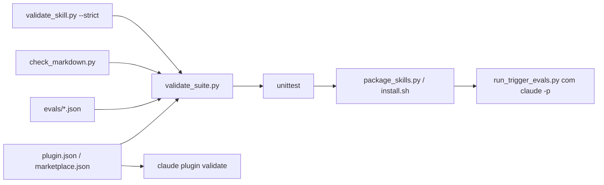

# Arquitetura da Power Suite

## Decisões principais

### 1. Uma skill por especialidade, sem dependências entre skills

Cada especialista é um diretório autocontido. Nenhum arquivo de uma skill
referencia arquivo de outra (verificado por `tools/validate_suite.py`).

- **Motivo**: skills são instaladas e enviadas individualmente (ZIP no
  claude.ai, upload na API, cópia no Claude Code). Uma dependência entre
  pastas quebraria em qualquer instalação parcial.
- **Custo aceito**: o padrão de detecção de blocos de código aparece
  duplicado em três scripts (`validate_skill.py`, `lint_prompt.py`,
  `check_markdown.py`).

### 2. Orquestrador por nome, não por arquivo

`orchestrating-power-suite` cita as demais skills pelo `name` e descreve
quando usar cada uma, sem ler os arquivos delas. Se só parte da suíte
estiver instalada, o orquestrador continua válido e o modelo aplica apenas
as skills presentes.

### 3. Divulgação progressiva em três níveis

| Nível | Conteúdo nesta suíte |
|---|---|
| Metadados | `name` + `description` com gatilhos em português e termos em inglês |
| SKILL.md | fluxo com checklist, critérios de pronto e formato de saída (todos abaixo de 200 linhas) |
| Recursos | `reference/*.md` com sumário (lidos sob demanda) e `scripts/*.py` (executados, não lidos) |

### 4. Scripts determinísticos com biblioteca padrão

Tudo que pode ser verificado por código virou script: validação de skill,
lint de prompt, numeração de ADR, sinais em diff, agrupamento de logs,
estrutura de Markdown e perfil de CSV.

- **Motivo**: a API executa skills sem rede e sem instalação de pacotes; a
  biblioteca padrão funciona nas três superfícies.
- Cada script tem códigos de saída documentados, mensagens em português com
  arquivo:linha, saída `--json` e nunca sobrescreve arquivos existentes
  (exceto a linha de status do ADR substituído, documentada).

### 5. Honestidade operacional embutida nas instruções

Todas as skills exigem declarar o que foi executado de fato versus apenas
inferido ou simulado, e trazem um procedimento manual para quando não há
ferramenta de execução de código.

## Fluxo de validação

## Como adicionar um especialista

1. `python3 skills/authoring-agent-skills/scripts/scaffold_skill.py NOME --description "..." --dest skills --with-reference --with-scripts`
2. Escreva `evals/NOME.json` com pelo menos 3 cenários.
3. Adicione a linha do especialista na tabela do orquestrador.
4. Rode `python3 tools/validate_suite.py` e `python3 -m unittest discover -s tests`.
5. Atualize `CHANGELOG.md` e a versão em `.claude-plugin/plugin.json`.
