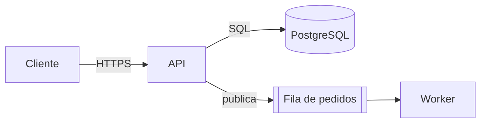

# Arquitetura de Software

## Princípio

Arquitetura é o conjunto de decisões caras de mudar. Toda recomendação
precisa estar ligada a um requisito ou atributo de qualidade **mensurável**;
recomendação sem essa ligação é preferência pessoal.

## Fluxo de trabalho

```text
- [ ] 1. Enquadrar o problema e os requisitos
- [ ] 2. Priorizar atributos de qualidade com cenários mensuráveis
- [ ] 3. Mapear o estado atual (se existir)
- [ ] 4. Gerar 2–4 opções reais, incluindo "mínima mudança"
- [ ] 5. Comparar na matriz de trade-offs
- [ ] 6. Recomendar e desenhar a opção escolhida
- [ ] 7. Registrar riscos, custos e critério de revisão
- [ ] 8. Criar o ADR
```

### 1. Enquadrar

Extraia ou pergunte (no máximo 5 perguntas, priorizando as que mudam a
decisão):
- objetivo de negócio e prazo;
- volume: usuários, requisições/s no pico, tamanho e crescimento de dados;
- restrições: stack existente, equipe (tamanho, experiência), orçamento,
  compliance (LGPD, PCI, HIPAA), nuvem/on-premise;
- integrações obrigatórias.

Sem números, trabalhe com **suposições explícitas** ("suponho 50 req/s no
pico; se for 5.000, a recomendação muda em X") em vez de travar.

### 2. Atributos de qualidade

Escolha os 3 mais importantes e escreva cada um como cenário:
`<estímulo> → <resposta> com <medida>`. Exemplo: "pico de 2.000 pedidos/min
→ confirmação ao cliente com p95 < 800 ms". Catálogo de atributos, táticas
e perguntas: [reference/quality-attributes.md](reference/quality-attributes.md).

### 3. Estado atual

Se houver código, leia antes de propor: pontos de entrada, módulos, banco,
filas, integrações, testes, deploy. Registre o que está funcionando e não
deve ser trocado sem motivo.

### 4. Opções

- Gere opções genuinamente diferentes, não variações cosméticas.
- Sempre inclua a opção de **menor mudança** que atenderia aos cenários.
- Para cada opção: descrição em 2–3 frases, o que muda, esforço estimado
  em ordem de grandeza (dias / semanas / meses) e principal risco.

### 5. Matriz de trade-offs

```markdown
| Critério (peso) | Opção A | Opção B | Opção C |
|---|---|---|---|
| Cenário 1: latência p95 (3) | 3 — cache local | 2 — 1 salto de rede | 1 — 2 saltos |
| Cenário 2: ... (2) | ... | ... | ... |
| Custo operacional (2) | ... | ... | ... |
| Esforço de implementação (1) | ... | ... | ... |
| **Total ponderado** | ... | ... | ... |
```

Notas 1–3 com justificativa curta em cada célula. A matriz apoia a decisão
mas não a substitui: se o total contrariar a intuição, explique o porquê.

### 6. Recomendar e desenhar

Entregue a visão da opção escolhida em dois níveis:
- **Contexto**: o sistema, usuários e sistemas externos.
- **Contêineres/componentes**: aplicações, bancos, filas e suas
  responsabilidades, protocolos e direção das dependências.

Use diagrama em Mermaid quando ajudar:



Descreva também o fluxo do cenário mais crítico passo a passo, incluindo o
que acontece quando cada dependência falha (timeout, retry, idempotência,
fallback).

### 7. Riscos e custos

Para cada risco: probabilidade (baixa/média/alta), impacto, mitigação e
sinal de alerta observável. Declare os custos aceitos (ex.: consistência
eventual, mais um componente para operar).

### 8. ADR

Crie o registro no repositório:

```bash
python3 scripts/new_adr.py "Usar fila para processar pedidos" --dir docs/adr
```

O script numera em sequência e nunca sobrescreve. Com
`--supersedes N` ele marca o ADR antigo como substituído. Preencha todas as
seções do arquivo gerado com o conteúdo das etapas 1–7. Se não houver
execução de código, crie o arquivo `docs/adr/NNNN-titulo.md` manualmente
com as seções: Contexto, Opções consideradas, Decisão, Consequências,
Critérios de revisão.

## Heurísticas de decisão

- Monólito modular antes de microsserviços, salvo necessidade comprovada de
  escalar ou implantar partes de forma independente, ou de times autônomos.
- Banco relacional como padrão; troque por outro modelo quando um padrão de
  acesso concreto o justificar (ex.: série temporal, grafo, chave-valor em
  latência muito baixa).
- Assíncrono (fila/eventos) quando o chamador não precisa do resultado
  imediato ou quando há picos que excedem a capacidade de processamento.
- Cache só com estratégia de invalidação definida e métrica de acerto.
- Prefira tecnologia que a equipe já opera bem; custo de aprendizado é
  custo real de projeto.
- Toda chamada remota precisa de timeout, política de retry com backoff e
  idempotência quando houver retry.

## Formato da resposta

1. Resumo da recomendação (3–5 linhas).
2. Requisitos e suposições.
3. Cenários de qualidade.
4. Opções + matriz.
5. Arquitetura proposta (diagrama + fluxo crítico + falhas).
6. Riscos e custos.
7. Próximos passos verificáveis e caminho do ADR.
